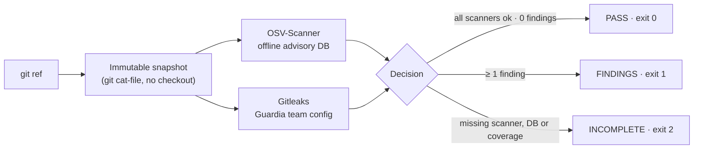

<div align="center">

# 🛡️ Guardia Offline

**Local, deterministic and verifiable security review of a Git commit.**
No LLM, no cloud, no credentials. Just the scanners, an offline advisory database, and a report that says exactly what was checked and what was not.

[](LICENSE)
[](.nvmrc)
[](tsconfig.json)
[](docs/scanners.md)
[](docs/scanners.md)
[](https://github.com/MauDevp/Hackathon_OpenIA_SecurityProject/actions/workflows/ci.yml)
[](#roadmap)

</div>

---

```text
$ guardia scan --repo ~/code/my-app --ref HEAD --out /tmp/my-app-report.json

guardia: FINDINGS (exit 1)
commit: cefa3873b9250f27d5eed940a468c5dd737893ea
isolation: not_requested
findings: 9
osv: ok (2.7.0)
gitleaks: ok (8.30.1)
report: /tmp/my-app-report.json
```

Three possible outcomes, and only three:

| Result | Exit code | Meaning |
| :--- | :---: | :--- |
| ✅ `PASS` | `0` | Every required scanner ran on the full snapshot and reported nothing. **Not** "secure", only "nothing found with these tools and this data". |
| 🔴 `FINDINGS` | `1` | At least one vulnerability or secret was reported. The report lists each one. |
| ⚠️ `INCOMPLETE` | `2` | A scanner, a database or part of the snapshot was missing. Guardia refuses to turn missing coverage into a green light. |

> **Design rule:** missing coverage always wins over findings. A scan that could not check everything is never `PASS`.

---

## Table of contents

- [Why](#why)
- [How it works](#how-it-works)
- [Quick start](#quick-start)
- [Usage](#usage)
- [The report](#the-report)
- [Configuration](#configuration)
- [Running the tests](#running-the-tests)
- [Repository layout](#repository-layout)
- [Limits you should know](#limits-you-should-know)
- [Roadmap](#roadmap)
- [Documentation](#documentation)
- [Contributing and license](#contributing-and-license)

---

## Why

Teams using AI coding assistants on private repositories often cannot, or do not want to, send their code to a remote scanner. They still need an answer to a simple question before merging:

> *Does this exact commit introduce a known-vulnerable dependency or a leaked secret, and can I prove what was checked?*

Guardia answers that question **offline and reproducibly**:

- 📌 **Immutable snapshot.** It analyzes a Git ref, not your working tree. The commit hash is in the report.
- 🔌 **Works without network.** Scanners run in `--offline` mode against an advisory database you downloaded beforehand.
- 🧾 **Explicit coverage.** The report lists the lockfiles analyzed, the files omitted, the scanner versions and the database checksum.
- 🧱 **Built on proven open source.** [OSV-Scanner](https://github.com/google/osv-scanner) for dependencies, [Gitleaks](https://github.com/gitleaks/gitleaks) for secrets. Guardia orchestrates; it does not reinvent detection.
- 🔒 **Hostile-repo safe.** Executables inside the analyzed repository are never run, repository-level Gitleaks allowlists and `.gitleaksignore` are ignored, symlinks are never materialized, and the report path must live outside the repository.

The full reasoning, competitive analysis and roadmap live in the [research report](docs/research/investigacion-seguridad-ia-opensource.md).

---

## How it works



1. **Snapshot.** Guardia resolves `--ref` to a commit and copies every blob into a private temporary directory using `git cat-file`. Nothing is checked out, so your working tree is untouched. Symlinks and submodules are recorded as excluded.
2. **Scan.** Both scanners run concurrently against the snapshot, each as a shell-free child process with a timeout, an output cap and a minimal environment allowlist. OSV-Scanner runs once per lockfile so that one bad lockfile cannot hide another.
3. **Decide and report.** The orchestrator applies the three-state rule above, redacts anything that looks like a secret, and writes the JSON report atomically with mode `0600`.
4. **Clean up.** The snapshot directory is always deleted, even on failure.

---

## Quick start

Everything below is for **Linux x86_64**. Other platforms work the same way with the matching release assets from each scanner.

### 1. Prerequisites

| Requirement | Version | Check |
| :--- | :--- | :--- |
| Node.js | 22 or newer | `node --version` |
| Git | any recent | `git --version` |
| `curl`, `tar`, `sha256sum` | standard | shipped with most distros |

### 2. Install Guardia

```bash
git clone https://github.com/MauDevp/Hackathon_OpenIA_SecurityProject.git guardia-offline
cd guardia-offline
nvm use            # optional, picks Node 22 from .nvmrc
npm ci
npm run build
node dist/cli/index.js --help
```

Optional, to get a global `guardia` command on your `PATH`:

```bash
npm link
guardia --help
```

### 3. Install the scanners

Guardia **does not download or bundle** the scanners. Install the pinned versions into the project-local, Git-ignored folder `.guardia/tools/`. Checksums are verified against the files published with each release.

```bash
mkdir -p .guardia/tools dl && cd dl

# OSV-Scanner 2.7.0
curl -fsSLO https://github.com/google/osv-scanner/releases/download/v2.7.0/osv-scanner_linux_amd64
curl -fsSLO https://github.com/google/osv-scanner/releases/download/v2.7.0/osv-scanner_SHA256SUMS
sha256sum --ignore-missing -c osv-scanner_SHA256SUMS
install -m 0755 osv-scanner_linux_amd64 ../.guardia/tools/osv-scanner

# Gitleaks 8.30.1
curl -fsSLO https://github.com/gitleaks/gitleaks/releases/download/v8.30.1/gitleaks_8.30.1_linux_x64.tar.gz
curl -fsSLO https://github.com/gitleaks/gitleaks/releases/download/v8.30.1/gitleaks_8.30.1_checksums.txt
sha256sum --ignore-missing -c gitleaks_8.30.1_checksums.txt
tar -xzf gitleaks_8.30.1_linux_x64.tar.gz gitleaks && install -m 0755 gitleaks ../.guardia/tools/gitleaks

cd .. && rm -rf dl
.guardia/tools/osv-scanner --version | head -1   # osv-scanner version: 2.7.0
.guardia/tools/gitleaks version                   # 8.30.1
```

Then tell Guardia where they are. Either option works:

```bash
# Option A: environment variables (absolute paths)
export GUARDIA_OSV_SCANNER_BIN="$PWD/.guardia/tools/osv-scanner"
export GUARDIA_GITLEAKS_BIN="$PWD/.guardia/tools/gitleaks"

# Option B: put them on the PATH
export PATH="$PWD/.guardia/tools:$PATH"
```

Already have both tools installed system-wide? Skip this step; Guardia finds them on `PATH`. The adapters were written against the pinned versions above, so other versions may behave differently.

### 4. Download the offline advisory database (once, needs network)

OSV-Scanner downloads one database per ecosystem the first time it sees a lockfile for it. Point it at a lockfile of **each ecosystem you plan to scan**. The bundled fixture triggers the npm database:

```bash
OSV_SCANNER_LOCAL_DB_CACHE_DIRECTORY="$PWD/.guardia/osv-db" \
  .guardia/tools/osv-scanner scan --offline --download-offline-databases \
  -L fixtures/adapters/npm-vulnerable/package-lock.json --format json > /dev/null
```

The npm database is about 220 MB. It lands in `.guardia/osv-db/osv-scalibr/npm/all.zip`, which is the default location Guardia looks at when run from this directory. From then on, no network is required.

### 5. Run your first scan

```bash
node dist/cli/index.js scan \
  --repo /path/to/your/repository \
  --ref HEAD \
  --out /tmp/guardia-report.json
```

You will get the terminal summary shown at the top of this page and a JSON report at the path you chose.

> 💡 Want to see `FINDINGS` right away? Scan this very repository: its `fixtures/` folder contains a deliberately vulnerable `lodash@4.17.20` lockfile and synthetic fake secrets.
>
> ```bash
> node dist/cli/index.js scan --repo . --ref HEAD --out /tmp/guardia-self.json
> ```

---

## Usage

```text
guardia scan --repo <path> --ref <git-ref> --out <report.json> [--strict-offline]
```

| Flag | Required | Description |
| :--- | :---: | :--- |
| `--repo <path>` | ✔ | Path to an existing Git repository. |
| `--ref <git-ref>` | ✔ | Anything `git rev-parse` resolves to a commit: `HEAD`, a branch, a tag, a SHA. |
| `--out <file>` | ✔ | Where to write the JSON report. **Must be outside the repository.** Written atomically with mode `0600`. |
| `--strict-offline` | | Fail closed unless network isolation is *verified*. No verification mechanism exists yet, so this flag currently always yields `INCOMPLETE`. See [Limits](#limits-you-should-know). |
| `--help`, `-h` | | Print usage. |

Usage errors (unknown flag, missing value, `--out` inside the repo) print a one-line message and exit with code `2`. A ref that does not resolve is not a usage error: Guardia still writes an `INCOMPLETE` report and exits `2`.

### Use it as a gate

Because the exit code encodes the outcome, Guardia drops into any script:

```bash
#!/usr/bin/env bash
# .git/hooks/pre-push (example)
set -u
node /path/to/guardia-offline/dist/cli/index.js scan \
  --repo "$(git rev-parse --show-toplevel)" --ref HEAD --out /tmp/guardia-pre-push.json
case $? in
  0) echo "guardia: PASS" ;;
  1) echo "guardia: FINDINGS, see /tmp/guardia-pre-push.json"; exit 1 ;;
  *) echo "guardia: INCOMPLETE, fix the setup before trusting this result"; exit 1 ;;
esac
```

---

## The report

`formatVersion` `1.0`, described by [schemas/guardia-report-1.0.schema.json](schemas/guardia-report-1.0.schema.json) and validated by the test suite. Top-level keys:

| Key | What it holds |
| :--- | :--- |
| `status`, `exitCode`, `executedAt` | Outcome, its exit code and the UTC timestamp. |
| `commit` | The full SHA that was analyzed. |
| `isolation` | `{ status: "verified" \| "unverified" \| "not_requested", strictOffline }`. |
| `snapshot` | `{ complete, excluded, omitted, error? }`: symlinks and submodules excluded, blobs that could not be copied. |
| `lockfiles` | Lockfiles detected by name in the snapshot. |
| `filesAnalyzed` | Union of the files every scanner confirmed as fully reviewed. |
| `omitted` | Files detected but not analyzed, each as `<scanner>: <path>: <reason>`. |
| `scanners[]` | One entry per scanner: `scanner`, `status` (`ok` \| `missing` \| `unsupported` \| `error`), `version`, and for OSV the `database` `{ downloadedAt, sourceDate, sha256 }`. |
| `findings[]` | `{ scanner, type, id, path, line?, summary }`. `type` is `dependency` or `secret`. Secrets are redacted twice: by Gitleaks and by Guardia. |

Example finding:

```json
{
  "scanner": "osv",
  "type": "dependency",
  "id": "GHSA-35jh-r3h4-6jhm",
  "path": "fixtures/adapters/npm-vulnerable/package-lock.json",
  "summary": "lodash@4.17.20: Command Injection in lodash"
}
```

Detected lockfile names: `package-lock.json`, `npm-shrinkwrap.json`, `yarn.lock`, `pnpm-lock.yaml`, `bun.lock`, `poetry.lock`, `Pipfile.lock`, `requirements.txt`, `uv.lock`, `pdm.lock`. Whether OSV-Scanner can parse each one depends on the scanner; unsupported files are reported as `omitted`, never silently skipped.

---

## Configuration

Guardia has no config file. Everything is an environment variable:

| Variable | Default | Purpose |
| :--- | :--- | :--- |
| `GUARDIA_OSV_SCANNER_BIN` | search `PATH` | Absolute path to the `osv-scanner` binary. |
| `GUARDIA_GITLEAKS_BIN` | search `PATH` | Absolute path to the `gitleaks` binary. |
| `OSV_SCANNER_LOCAL_DB_CACHE_DIRECTORY` | `.guardia/osv-db` relative to the **current directory** | Where the offline advisory databases live. Set it to an absolute path if you run Guardia from somewhere else. |
| `GUARDIA_INTEGRATION` | unset | Set to `1` to enable the real-binary integration tests. |

Child processes receive only `PATH` and `HOME`, plus `OSV_SCANNER_LOCAL_DB_CACHE_DIRECTORY` for OSV-Scanner. Nothing else from your shell leaks into the scanners.

**Gitleaks rules.** Every run passes `--config rules/gitleaks/guardia.toml`, which extends the default Gitleaks rule set and adds no allowlists. A `.gitleaks.toml`, `.gitleaksignore` or inline `gitleaks:allow` comment inside the analyzed repository is deliberately ignored: the repository under review must not be able to silence its own findings.

**Database metadata.** If `.guardia/osv-db/guardia-db-meta.json` exists, Guardia copies its `downloadedAt` into the report (`sourceDate` is always `null` today: the OSV source does not publish one). The SHA-256 of the database zip is recomputed on every run, so a replaced database is always visible.

---

## Running the tests

```bash
npm test                        # 58 unit and contract tests, fake scanners, no network
npm run typecheck               # tsc --noEmit
GUARDIA_INTEGRATION=1 npm test  # adds 7 tests against the real binaries and database
```

The unit suite drives the adapters with a fake tool, so it runs anywhere. The integration suite needs the scanners and the npm database from the Quick start and checks the real lodash advisories, an empty database, a hostile `.gitleaks.toml` and `.gitleaksignore`, among others.

---

## Repository layout

```text
src/
  cli/        argument parsing, atomic report writing, exit codes
  core/       snapshot (git cat-file), orchestrator (PASS/FINDINGS/INCOMPLETE), report
  adapters/   runner, osv, gitleaks, scanAll; one adapter per external scanner
  policy/     reserved for a future configurable policy (README only today)
rules/        Gitleaks team configuration passed with --config on every run
fixtures/     synthetic repositories: clean, vulnerable and fake-secret cases
tests/        core and adapter tests, plus opt-in real-binary integration tests
docs/         architecture, scanner behaviour, decisions, research report
schemas/      versioned JSON Schema of the report (guardia-report-1.0.schema.json)
examples/     reserved for CI and hook examples (README only today)
.guardia/     Git-ignored: scanner binaries and offline databases
```

---

## Limits you should know

Guardia is honest about what it is not. Read these before relying on it:

- **`PASS` is not "secure".** It means two scanners with a specific database found nothing on the files they support. Logic bugs, misconfigurations and anything outside the OSV and Gitleaks rule sets are out of scope.
- **Network isolation is not verified.** `--offline` tells OSV-Scanner not to call home, but Guardia does not yet sandbox or trace the process. `--strict-offline` therefore always returns `INCOMPLETE` until a verified isolation mechanism exists.
- **No severity threshold.** Every finding counts; there is no "fail only on HIGH" option yet.
- **Database freshness is your job.** Guardia reports the download time and checksum; it never refreshes the database for you.
- **Working directory matters.** The default database path is relative to where you run Guardia. Use an absolute `OSV_SCANNER_LOCAL_DB_CACHE_DIRECTORY` in scripts.
- **Static analysis is not included.** Semgrep CE is a candidate for a later adapter, not a feature.
- **Pinned to Linux-tested versions.** OSV-Scanner 2.7.0 and Gitleaks 8.30.1 were the versions whose behaviour was observed and recorded in [docs/scanners.md](docs/scanners.md).

---

## Roadmap

- [x] Immutable Git snapshot without checkout
- [x] OSV-Scanner offline adapter, one run per lockfile, database checksum in the report
- [x] Gitleaks adapter with team config, redaction and distrust of repository allowlists
- [x] Three-state decision with coverage-first rule and stable exit codes
- [x] JSON report written atomically outside the repository
- [x] JSON Schema for report format `1.0` under `schemas/`, validated in the test suite
- [x] CI workflow on Node 22 and 24 with a CLI smoke test
- [ ] Verified network isolation so `--strict-offline` can reach `PASS`
- [ ] `--db-dir` flag and a `guardia db download` helper
- [ ] Severity threshold and per-finding suppression with an audit trail
- [ ] SARIF export
- [ ] Semgrep CE adapter (optional static analysis)
- [ ] Ready-to-copy hook and pipeline examples under `examples/`
- [ ] Evaluate integration with the OpenQodex scan mode (see [docs/decisiones.md](docs/decisiones.md))

---

## Documentation

| Document | What you will find |
| :--- | :--- |
| [docs/architecture.md](docs/architecture.md) | The v1 flow, boundaries and exit states. |
| [docs/scanners.md](docs/scanners.md) | Every command, exit code and quirk observed on the pinned scanner versions, with checksums. |
| [docs/decisiones.md](docs/decisiones.md) | Why v1 has its own small core instead of extending OpenQodex today. |
| [docs/research/](docs/research/) | The research report that motivates the project: problem, competitors, costs, roadmap. |
| [SECURITY.md](SECURITY.md) | How to report a vulnerability in Guardia itself. |

---

## Contributing and license

Contributions are welcome. Read [CONTRIBUTING.md](CONTRIBUTING.md) and the [Code of Conduct](CODE_OF_CONDUCT.md) first. Fixtures must stay synthetic: never commit a real secret, even a revoked one.

Licensed under **Apache-2.0**. See [LICENSE](LICENSE) and [NOTICE](NOTICE). OSV-Scanner and Gitleaks keep their own licenses and are not redistributed in this repository.

<div align="center">
<sub>Built for people who want to know exactly what was checked before they trust a green light.</sub>
</div>
