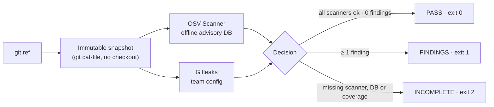

<div align="center">

# 🛡️ DMsecurity

### Know exactly what was checked before you trust a green light.

**DMsecurity scans a Git commit for known-vulnerable dependencies and leaked secrets, fully offline, and tells you precisely what it covered and what it could not.**

[](https://github.com/MauDevp/Hackathon_OpenIA_SecurityProject/actions/workflows/ci.yml)
[](LICENSE)
[](.nvmrc)
[](tsconfig.json)
[](docs/scanners.md)
[](docs/scanners.md)
[](#roadmap)

</div>

---

## What is DMsecurity?

Most security scanners give you a list of problems. Very few tell you what they **did not** look at. DMsecurity was built around that gap.

It takes one Git commit, copies it into a private snapshot, runs two proven open source scanners against it, and produces a single verdict with an honest coverage statement:

| Verdict | Exit code | What it really means |
| :--- | :---: | :--- |
| ✅ `PASS` | `0` | Every scanner ran on the whole snapshot and reported nothing. **Not** "secure", only "nothing found with these tools and this data". |
| 🔴 `FINDINGS` | `1` | At least one known vulnerability or leaked secret. Each one is listed in the report. |
| ⚠️ `INCOMPLETE` | `2` | A scanner, a database or part of the snapshot was missing. DMsecurity refuses to turn missing coverage into a green light. |

> **The one rule:** missing coverage always wins over findings. A scan that could not check everything is never `PASS`.

Everything runs on your machine. No LLM, no cloud, no credentials, no network once the advisory database is downloaded. The report records the commit hash, the scanner versions, the database checksum and every file it skipped, so a human, a Git hook or a CI job can verify the claim instead of trusting it.

```text
$ npm run scan -- --repo ~/code/my-app --ref HEAD --out /tmp/my-app-report.json

guardia: FINDINGS (exit 1)
commit: cefa3873b9250f27d5eed940a468c5dd737893ea
isolation: not_requested
findings: 9
osv: ok (2.7.0)
gitleaks: ok (8.30.1)
report: /tmp/my-app-report.json
```

The command-line tool is called `guardia`, the project's original name. It stays that way so existing scripts keep working.

---

## Why it exists

Teams using AI coding assistants on private repositories often cannot, or do not want to, send their code to a remote scanner. They still need an answer before merging:

> *Does this exact commit introduce a known-vulnerable dependency or a leaked secret, and can I prove what was checked?*

DMsecurity answers that offline and reproducibly:

- 📌 **Immutable snapshot.** It analyzes a Git ref, never your working tree. The commit hash is in the report.
- 🔌 **Air-gap friendly.** Scanners run in `--offline` mode against an advisory database you downloaded beforehand.
- 🧾 **Explicit coverage.** Lockfiles analyzed, files omitted, scanner versions and database checksum are all in the JSON.
- 🧱 **Built on proven open source.** [OSV-Scanner](https://github.com/google/osv-scanner) for dependencies, [Gitleaks](https://github.com/gitleaks/gitleaks) for secrets. DMsecurity orchestrates; it does not reinvent detection.
- 🔒 **Hostile-repo safe.** Executables inside the analyzed repository are never run, repository-level Gitleaks allowlists and `.gitleaksignore` are ignored, symlinks are never materialized, and the report must live outside the repository.
- 📐 **Machine-checkable output.** The report follows a published [JSON Schema](schemas/guardia-report-1.0.schema.json) and is validated by the test suite.

The full reasoning, competitive analysis and roadmap live in the [research report](docs/research/investigacion-seguridad-ia-opensource.md).

---

## How it works



1. **Snapshot.** The ref is resolved to a commit and every blob is copied into a private temporary directory with `git cat-file`. Nothing is checked out. Symlinks and submodules are recorded as excluded.
2. **Scan.** Both scanners run concurrently as shell-free child processes with a timeout, an output cap and a minimal environment. OSV-Scanner runs once per lockfile so one bad lockfile cannot hide another.
3. **Decide and report.** The three-state rule above is applied, anything that looks like a secret is redacted, and the JSON report is written atomically with mode `0600`.
4. **Clean up.** The snapshot is always deleted, even on failure.

---

## Quick start

One command on Linux x86_64 after installing Node 22+ and npm. It downloads
the scanners, verifies them, asks for the repository and WhatsApp recipient,
shows the QR, and can activate periodic checks and the pre-commit hook. Other
platforms: see [manual setup](#manual-setup) below.

```bash
git clone https://github.com/MauDevp/Hackathon_OpenIA_SecurityProject.git dmsecurity
cd dmsecurity
bash scripts/install.sh
```

The setup assistant asks before linking WhatsApp, enabling a systemd user timer
or installing a Git pre-commit hook. It never overwrites an existing hook.
Your WhatsApp recipient is stored privately in
`~/.config/dmsecurity/whatsapp.json`, so it does not need to be exported again.
After configuration, it sends `DMsecurity · La configuración ha sido completada.`
and immediately runs the first verification; that result is also notified,
including a clean `PASS` result.

What `bash scripts/install.sh` does, so you can trust it:

- Downloads **OSV-Scanner 2.7.0** and **Gitleaks 8.30.1** from their GitHub releases into the Git-ignored folder `.guardia/tools/` and verifies each SHA-256 against the values recorded in [docs/scanners.md](docs/scanners.md). Your system stays untouched.
- Downloads the OSV advisory database for npm (about 220 MB, once) into `.guardia/osv-db/` and writes the metadata the report uses. Need other ecosystems? Pass one lockfile per ecosystem: `npm run setup -- --lockfile /path/to/poetry.lock`.
- Is safe to re-run. Present binaries are kept, and so is the database when you pass no `--lockfile`; `npm run setup -- --refresh-db` or an explicit `--lockfile` downloads fresh advisories.
- Starts `guardia onboard` in an interactive terminal. Use `npm run setup -- --no-onboard` for automation without prompts.

`npm run scan` is `guardia scan` with the environment already pointed at those folders. Run it from the DMsecurity directory.

> 💡 Want to see `FINDINGS` right away? Scan this very repository: its `fixtures/` folder holds a deliberately vulnerable `lodash@4.17.20` lockfile and synthetic fake secrets.
>
> ```bash
> npm run scan -- --repo . --ref HEAD --out /tmp/self-report.json
> ```

---

## Automate it

### On your machine: cron or a systemd timer

`scripts/scheduled-scan.sh` scans one repository, keeps every report under `~/.local/state/guardia/<repo>/`, appends a line to `history.log`, and sends a **desktop notification** when the result is `FINDINGS` or `INCOMPLETE`.

```bash
# Try it once
scripts/scheduled-scan.sh /path/to/your/repository

# Every weekday at 09:00 (crontab -e). Cron has no session bus, so pass it for the desktop notification.
0 9 * * 1-5 DBUS_SESSION_BUS_ADDRESS=unix:path=/run/user/$(id -u)/bus /path/to/dmsecurity/scripts/scheduled-scan.sh /path/to/repo >> ~/.local/state/guardia/cron.log 2>&1
```

Set `GUARDIA_NOTIFY=none` to silence notifications and `GUARDIA_STATE_DIR` to move the reports. Without a session bus the scan still runs and logs; only the pop-up is skipped.

### Optional WhatsApp alerts

WhatsApp delivery is opt-in and sends a short, redacted summary only. It never
sends source code, secret values or the JSON report. It uses a local
[Baileys](https://github.com/WhiskeySockets/Baileys) WhatsApp Web session: no
Meta Cloud API, developer account or token is needed. Link the sending account
once by QR. The one-command installer does this interactively and persists the
destination privately, so no environment variables are needed for normal use.

```bash
# During bash scripts/install.sh answer the prompts, then scan the QR from
# WhatsApp: Settings > Linked devices > Link a device.
# Enter the destination with country code, for example +521XXXXXXXXXX.
```

Delivery failures remain in a private local outbox and never change the scan
verdict. The linked-session keys are stored in
`$XDG_STATE_HOME/dmsecurity/whatsapp-auth` (or under `DMSECURITY_STATE_DIR`)
with restricted permissions. If WhatsApp invalidates the linked device, run
`guardia whatsapp login` again. `DMSECURITY_WHATSAPP_RECIPIENT` remains an
optional per-process override for advanced use. WhatsApp cannot be combined with
`--strict-offline`, because sending a message requires network access.

To start a link from scratch, first remove the DMsecurity device in WhatsApp's
**Linked devices** screen, then run `guardia whatsapp reset` before onboarding
again. This removes only local linked-device credentials.

### Schedule a local recurring scan

The installer can create and activate a systemd user timer after an explicit
prompt. `schedule add` remains available for manual changes; it writes a
disabled timer and prints the exact activation command.

```bash
node dist/cli/index.js schedule add \
  --repo /path/to/repo --ref main --every 6h \
  --notify whatsapp --on findings,incomplete
node dist/cli/index.js schedule list
```

### Check staged changes before a commit

`check-staged` reads Git's staged index directly and creates a temporary
snapshot; it does not write, stash or check out the target repository. The
installer can add the optional hook after confirmation. For manual changes:

```bash
node dist/cli/index.js hook install --repo /path/to/repo --mode block --notify whatsapp
```

`block` rejects `FINDINGS` and `INCOMPLETE`; `warn` prints the result but lets
the commit proceed. DMsecurity never overwrites an existing pre-commit hook.
To also receive a WhatsApp confirmation for a clean staged change, add
`--on pass,findings,incomplete` when installing the hook; this is off by
default to avoid notification noise.

### In GitHub: scheduled scan that opens an issue

Copy [`examples/scheduled-scan.yml`](examples/scheduled-scan.yml) into `.github/workflows/` of the repository you want to watch. Every weekday morning it scans the default branch, uploads the report as an artifact and, when the result is not `PASS`, **opens or updates one issue** labelled `dmsecurity` and fails the run. GitHub's own notifications become your alert channel: no bots, no external accounts.

### As a gate in any script

The exit code encodes the outcome, so DMsecurity drops into a pre-push hook or a pipeline as is:

```bash
node /path/to/dmsecurity/dist/cli/index.js scan --repo "$(git rev-parse --show-toplevel)" --ref HEAD --out /tmp/pre-push.json
case $? in
  0) echo "PASS" ;;
  1) echo "FINDINGS, see /tmp/pre-push.json"; exit 1 ;;
  *) echo "INCOMPLETE, fix the setup before trusting this result"; exit 1 ;;
esac
```

---

## Usage

```text
guardia scan --repo <path> --ref <git-ref> --out <report.json> [--strict-offline]
```

| Flag | Required | Description |
| :--- | :---: | :--- |
| `--repo <path>` | ✔ | Path to an existing Git repository. |
| `--ref <git-ref>` | ✔ | Anything `git rev-parse` resolves to a commit: `HEAD`, a branch, a tag, a SHA. |
| `--out <file>` | ✔ | Where to write the JSON report. **Must be outside the repository.** Written atomically with mode `0600`. |
| `--strict-offline` | | Fail closed unless network isolation is *verified*. No verification mechanism exists yet, so this flag always yields `INCOMPLETE`. See [Limits](#limits-you-should-know). |
| `--help`, `-h` | | Print usage. |

Usage errors (unknown flag, missing value, `--out` inside the repo) print a one-line message and exit with code `2`. A ref that does not resolve is not a usage error: DMsecurity still writes an `INCOMPLETE` report and exits `2`.

---

## The report

`formatVersion` `1.0`, described by [schemas/guardia-report-1.0.schema.json](schemas/guardia-report-1.0.schema.json) and validated by the test suite. Top-level keys:

| Key | What it holds |
| :--- | :--- |
| `status`, `exitCode`, `executedAt` | Outcome, its exit code and the UTC timestamp. |
| `commit` | The full SHA that was analyzed. |
| `isolation` | `{ status: "verified" \| "unverified" \| "not_requested", strictOffline }`. |
| `snapshot` | `{ complete, excluded, omitted, error? }`: symlinks and submodules excluded, blobs that could not be copied. |
| `lockfiles` | Lockfiles detected by name in the snapshot. |
| `filesAnalyzed` | Union of the files every scanner confirmed as fully reviewed. |
| `omitted` | Files detected but not analyzed, each as `<scanner>: <path>: <reason>`. |
| `scanners[]` | One entry per scanner: `scanner`, `status` (`ok` \| `missing` \| `unsupported` \| `error`), `version`, and for OSV the `database` `{ downloadedAt, sourceDate, sha256 }`. |
| `findings[]` | `{ scanner, type, id, path, line?, summary }`. `type` is `dependency` or `secret`. Secrets are redacted twice: by Gitleaks and by DMsecurity. |

Example finding:

```json
{
  "scanner": "osv",
  "type": "dependency",
  "id": "GHSA-35jh-r3h4-6jhm",
  "path": "fixtures/adapters/npm-vulnerable/package-lock.json",
  "summary": "lodash@4.17.20: Command Injection in lodash"
}
```

Detected lockfile names: `package-lock.json`, `npm-shrinkwrap.json`, `yarn.lock`, `pnpm-lock.yaml`, `bun.lock`, `poetry.lock`, `Pipfile.lock`, `requirements.txt`, `uv.lock`, `pdm.lock`. Files the scanner cannot parse are reported as `omitted`, never silently skipped.

---

## Configuration

Scanner settings use environment variables, and `npm run scan` sets the first
three for you. The interactive installer additionally stores the WhatsApp
destination in a private local configuration file.

| Variable | Default | Purpose |
| :--- | :--- | :--- |
| `GUARDIA_OSV_SCANNER_BIN` | search `PATH` | Absolute path to the `osv-scanner` binary. |
| `GUARDIA_GITLEAKS_BIN` | search `PATH` | Absolute path to the `gitleaks` binary. |
| `OSV_SCANNER_LOCAL_DB_CACHE_DIRECTORY` | `.guardia/osv-db` relative to the **current directory** | Where the offline advisory databases live. Use an absolute path in scripts. |
| `GUARDIA_DIR` | `<dmsecurity>/.guardia` | Where `scripts/setup.sh` and `scripts/scheduled-scan.sh` keep binaries and databases. |
| `GUARDIA_STATE_DIR` | `~/.local/state/guardia` | Where `scripts/scheduled-scan.sh` stores reports and `history.log`. |
| `GUARDIA_NOTIFY` | `desktop` | `none` disables desktop notifications in the scheduled scan. |
| `GUARDIA_NOTIFY_ON` | `findings,incomplete` | Scheduled WhatsApp notification kinds. |
| `DMSECURITY_STATE_DIR` | XDG state directory | Private notification outbox and delivery history. |
| `DMSECURITY_CONFIG_DIR` | XDG config directory | Private local configuration, including the configured WhatsApp destination. |
| `DMSECURITY_WHATSAPP_RECIPIENT` | saved local destination | Optional per-process override in international E.164 digits; no API token is used. |
| `GUARDIA_INTEGRATION` | unset | Set to `1` to enable the real-binary integration tests. |

Child processes receive only `PATH` and `HOME`, plus `OSV_SCANNER_LOCAL_DB_CACHE_DIRECTORY` for OSV-Scanner. Nothing else from your shell leaks into the scanners.

**Gitleaks rules.** Every run passes `--config rules/gitleaks/guardia.toml`, which extends the default Gitleaks rule set and adds no allowlists. A `.gitleaks.toml`, `.gitleaksignore` or inline `gitleaks:allow` comment inside the analyzed repository is deliberately ignored: the repository under review must not be able to silence its own findings.

**Database metadata.** `npm run setup` writes `.guardia/osv-db/guardia-db-meta.json`; DMsecurity copies its `downloadedAt` into the report (`sourceDate` is always `null` today, the OSV source does not publish one). The SHA-256 of the database zip is recomputed on every run, so a replaced database is always visible.

---

## Manual setup

<details>
<summary>Install the scanners and the database by hand (any platform)</summary>

DMsecurity never bundles the scanners. Get the pinned versions from their releases, verify them, and tell DMsecurity where they are. The Linux x86_64 commands, with checksums, are in [docs/scanners.md](docs/scanners.md); for other platforms pick the matching release asset.

```bash
export GUARDIA_OSV_SCANNER_BIN=/absolute/path/to/osv-scanner   # 2.7.0
export GUARDIA_GITLEAKS_BIN=/absolute/path/to/gitleaks         # 8.30.1
export OSV_SCANNER_LOCAL_DB_CACHE_DIRECTORY=/absolute/path/to/osv-db

# Download one advisory database per ecosystem (network required, once)
osv-scanner scan --offline --download-offline-databases -L /path/to/package-lock.json --format json > /dev/null

node dist/cli/index.js scan --repo /path/to/repository --ref HEAD --out /tmp/report.json
```

Already have both tools on `PATH`? Skip the first two exports. The adapters were written against the pinned versions, so other versions may behave differently.

</details>

---

## Running the tests

```bash
npm test                        # 58 unit and contract tests, fake scanners, no network
npm run typecheck               # tsc --noEmit
GUARDIA_INTEGRATION=1 npm test  # adds 7 tests against the real binaries and database
```

The unit suite drives the adapters with a fake tool, so it runs anywhere. The integration suite needs the scanners and the npm database from `npm run setup` and checks the real lodash advisories, an empty database, a hostile `.gitleaks.toml` and `.gitleaksignore`, among others.

---

## Repository layout

```text
src/
  cli/        argument parsing, atomic report writing, exit codes
  core/       snapshot (git cat-file), orchestrator (PASS/FINDINGS/INCOMPLETE), report
  adapters/   runner, osv, gitleaks, scanAll; one adapter per external scanner
  policy/     reserved for a future configurable policy (README only today)
scripts/      setup.sh (scanners + database) and scheduled-scan.sh (cron + notification)
              pre-commit.sh (opt-in staged-index gate)
src/notifications/  redacted events, private outbox and WhatsApp transport
examples/     scheduled GitHub Actions workflow that opens an issue on findings
rules/        Gitleaks team configuration passed with --config on every run
schemas/      versioned JSON Schema of the report
fixtures/     synthetic repositories: clean, vulnerable and fake-secret cases
tests/        core and adapter tests, plus opt-in real-binary integration tests
docs/         architecture, scanner behaviour, decisions, research report
.guardia/     Git-ignored: scanner binaries and offline databases
```

---

## Limits you should know

DMsecurity is honest about what it is not. Read these before relying on it:

- **`PASS` is not "secure".** It means two scanners with a specific database found nothing on the files they support. Logic bugs, misconfigurations and anything outside the OSV and Gitleaks rule sets are out of scope.
- **Network isolation is not verified.** `--offline` tells OSV-Scanner not to call home, but DMsecurity does not yet sandbox or trace the process. `--strict-offline` therefore always returns `INCOMPLETE`.
- **No severity threshold.** Every finding counts; there is no "fail only on HIGH" option yet.
- **Database freshness is your job.** The report shows the download time and checksum; run `npm run setup -- --refresh-db` to update.
- **Working directory matters.** The default database path is relative to where you run the CLI. `npm run scan` and the scripts handle this; raw `guardia` calls should use absolute paths.
- **Static analysis is not included.** Semgrep CE is a candidate for a later adapter, not a feature.
- **Automated setup is Linux x86_64 only.** Other platforms follow the manual steps.

---

## Roadmap

- [x] Immutable Git snapshot without checkout
- [x] OSV-Scanner offline adapter, one run per lockfile, database checksum in the report
- [x] Gitleaks adapter with team config, redaction and distrust of repository allowlists
- [x] Three-state decision with coverage-first rule and stable exit codes
- [x] JSON report written atomically outside the repository, with a published JSON Schema
- [x] CI workflow on Node 22 and 24 with a CLI smoke test
- [x] One-command setup with checksum verification, scheduled scan script, GitHub Actions alert example
- [ ] Verified network isolation so `--strict-offline` can reach `PASS`
- [ ] `--db-dir` flag so raw `guardia` calls need no environment variables
- [ ] Severity threshold and per-finding suppression with an audit trail
- [ ] SARIF export
- [ ] Semgrep CE adapter (optional static analysis)
- [ ] macOS and Windows support in `scripts/setup.sh`
- [ ] Evaluate integration with the OpenQodex scan mode (see [docs/decisiones.md](docs/decisiones.md))

---

## Documentation

| Document | What you will find |
| :--- | :--- |
| [docs/architecture.md](docs/architecture.md) | The v1 flow, boundaries and exit states. |
| [docs/scanners.md](docs/scanners.md) | Every command, exit code and quirk observed on the pinned scanner versions, with checksums. |
| [docs/decisiones.md](docs/decisiones.md) | Why v1 has its own small core instead of extending OpenQodex today. |
| [docs/research/](docs/research/) | The research report that motivates the project: problem, competitors, costs, roadmap. |
| [SECURITY.md](SECURITY.md) | How to report a vulnerability in DMsecurity itself. |

---

## Contributing and license

Contributions are welcome. Read [CONTRIBUTING.md](CONTRIBUTING.md) and the [Code of Conduct](CODE_OF_CONDUCT.md) first. Fixtures must stay synthetic: never commit a real secret, even a revoked one.

Licensed under **Apache-2.0**. See [LICENSE](LICENSE) and [NOTICE](NOTICE). OSV-Scanner and Gitleaks keep their own licenses and are not redistributed in this repository.

<div align="center">
<sub>DMsecurity · built for people who want to know exactly what was checked before they trust a green light.</sub>
</div>
